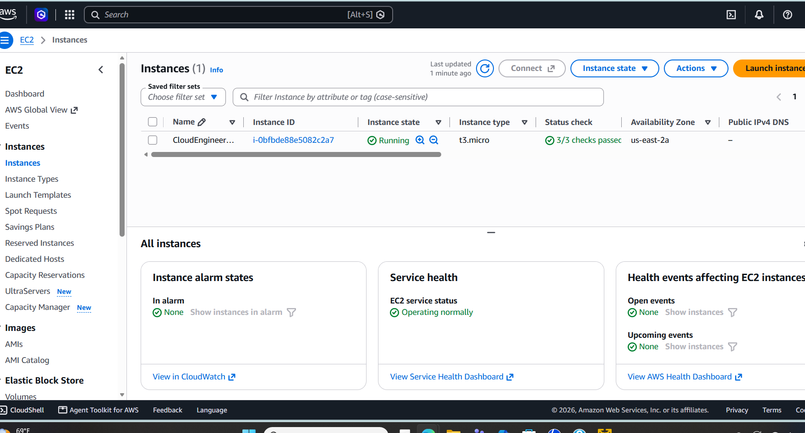
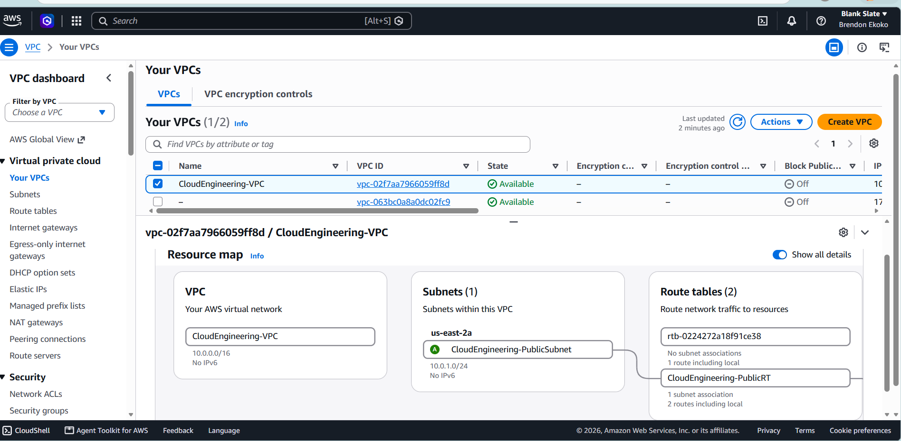
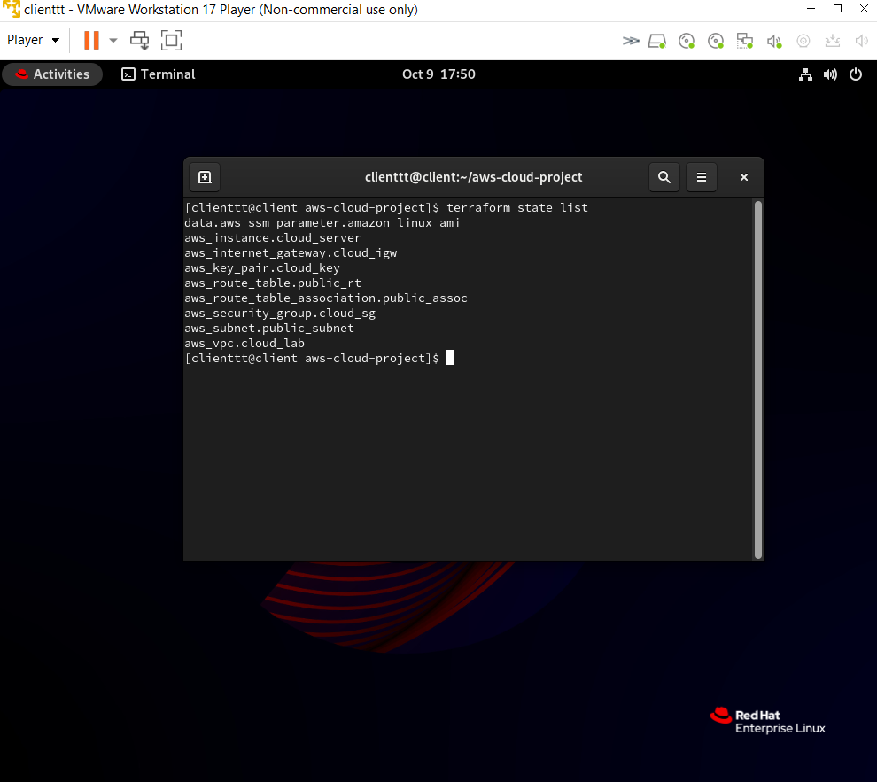
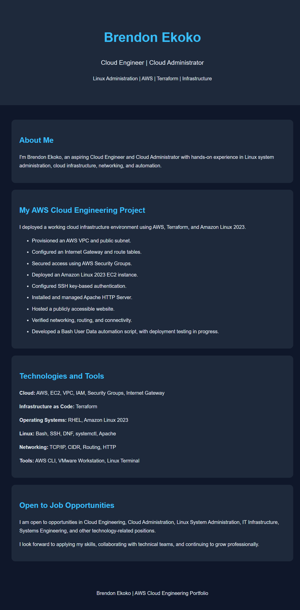
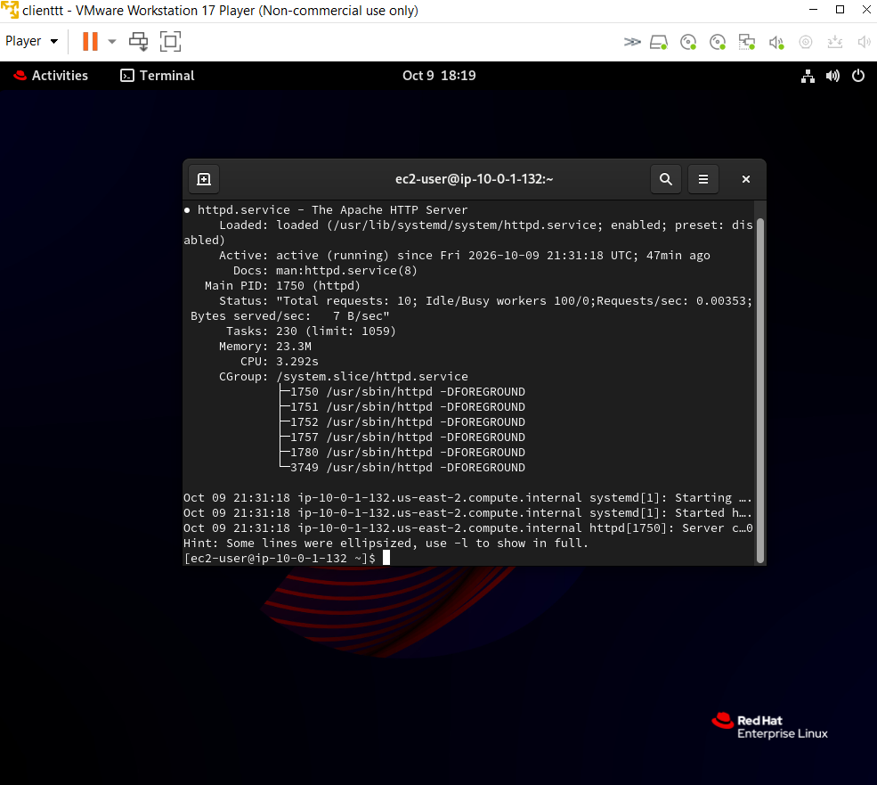

# AWS Cloud Engineering Infrastructure Project

**Brendon Ekoko | Cloud Engineering | Cloud Administration | Linux System Administration**

## Project Overview

This project demonstrates my hands-on experience deploying, configuring, securing, and managing cloud infrastructure using **Amazon Web Services (AWS), Terraform, and Linux**.

Using a Red Hat Enterprise Linux (RHEL) virtual machine as my administration workstation, I provisioned AWS infrastructure through Infrastructure as Code (IaC), deployed an Amazon Linux 2023 EC2 instance, configured networking and security, and hosted a publicly accessible portfolio website using Apache HTTP Server.

After completing and documenting the deployment, I successfully destroyed the Terraform-managed infrastructure to avoid unnecessary ongoing cloud costs.

## AWS Infrastructure Architecture

**Architecture:**

RHEL Administration Workstation → Terraform / AWS CLI → AWS VPC → Public Subnet → Amazon EC2 → Apache HTTP Server → Portfolio Website

**AWS Region:** us-east-2 (Ohio)

**Network configuration:**
- VPC CIDR: `10.0.0.0/16`
- Public subnet: `10.0.1.0/24`
- Availability Zone: `us-east-2a`
- Internet Gateway with public route `0.0.0.0/0`
- Security Group permitting HTTP (TCP 80) and restricted SSH (TCP 22)

**Compute configuration:**
- Amazon EC2 `t3.micro`
- Amazon Linux 2023
- 8 GiB gp3 EBS root volume
- SSH key-based authentication
- Apache HTTP Server (`httpd`)

## Technologies and Tools

| Category | Technologies |
|---|---|
| Cloud Platform | Amazon Web Services (AWS) |
| Infrastructure as Code | Terraform |
| Cloud Networking | VPC, Subnets, Internet Gateway, Route Tables, Security Groups |
| Compute | Amazon EC2, Amazon Linux 2023 |
| Linux Administration | RHEL, SSH, DNF, systemctl, Bash |
| Web Server | Apache HTTP Server |
| Command-Line Tools | AWS CLI, Terraform CLI, Git |
| Version Control | Git and GitHub |
| Virtualization | VMware Workstation |

## Project Implementation

### 1. Infrastructure Provisioning

- Created Terraform configuration files to define AWS infrastructure.
- Provisioned a VPC and public subnet.
- Configured an Internet Gateway, route table, and subnet association.
- Deployed an Amazon Linux 2023 EC2 instance.
- Verified provisioned resources using Terraform state commands and the AWS Management Console.

### 2. Network Configuration and Security

- Configured VPC and subnet CIDR ranges.
- Established a default route to the Internet Gateway.
- Restricted inbound SSH access to an approved public IP address.
- Allowed HTTP traffic on TCP port 80 for website access.
- Verified Linux network interfaces, IP addressing, routing, and outbound connectivity.

### 3. Linux Server Administration

- Connected to the EC2 instance using SSH key-based authentication.
- Installed Apache HTTP Server using the Linux package manager.
- Enabled and started the Apache service using systemd.
- Verified Apache service status and web server availability.
- Created and published a personal HTML portfolio website.

### 4. Infrastructure Automation

- Used Terraform to provision and manage AWS resources.
- Developed an EC2 User Data Bash script to automate Apache installation, service startup, and initial webpage creation.
- Configured Terraform to reference the User Data script.

**Automation status:** The script was configured, but a complete fresh-instance deployment test of the User Data automation remains a future improvement.

### 5. Infrastructure Cleanup and Cost Management

- Executed `terraform plan -destroy` to review the planned cleanup.
- Executed `terraform destroy` to remove eight Terraform-managed resources.
- Verified EC2 termination and confirmed no remaining EBS volumes or Elastic IP addresses in the project region.
- Checked AWS Billing and confirmed an amount due of $0.00 at the time of review.

## Project Screenshots

### EC2 Instance Deployment

### AWS VPC and Networking

### Terraform Infrastructure State

### AWS-Hosted Portfolio Website

### Apache HTTP Server Verification

## Skills Demonstrated

- AWS cloud infrastructure provisioning
- Infrastructure as Code using Terraform
- Linux server installation, configuration, and troubleshooting
- Cloud networking and security group configuration
- SSH key management and remote administration
- Apache web server deployment
- Bash scripting and automation fundamentals
- Git version control and GitHub project documentation
- Cloud resource lifecycle and cost management

## Future Improvements

- Validate fully automated Apache deployment on a newly created EC2 instance.
- Introduce HTTPS using TLS certificates.
- Configure CloudWatch monitoring and alerts.
- Expand the architecture to include private subnets and additional security controls.
- Improve Terraform reusability with variables, outputs, and modules.

## About Me

I'm **Brendon Ekoko**, an aspiring Cloud Engineer and Cloud Administrator with a background in Linux system administration, infrastructure, networking, and security.

I hold the **Red Hat Certified System Administrator (RHCSA)** and **CompTIA Security+** certifications.

I am open to opportunities in Cloud Engineering, Cloud Administration, Linux System Administration, IT Infrastructure, Systems Engineering, Cybersecurity, and related technology roles.

This project reflects my commitment to developing practical cloud engineering skills through hands-on infrastructure deployment and administration.

---

**Project Author:** Brendon Ekoko

**Status:** Completed and documented; AWS infrastructure decommissioned to minimize ongoing costs.
